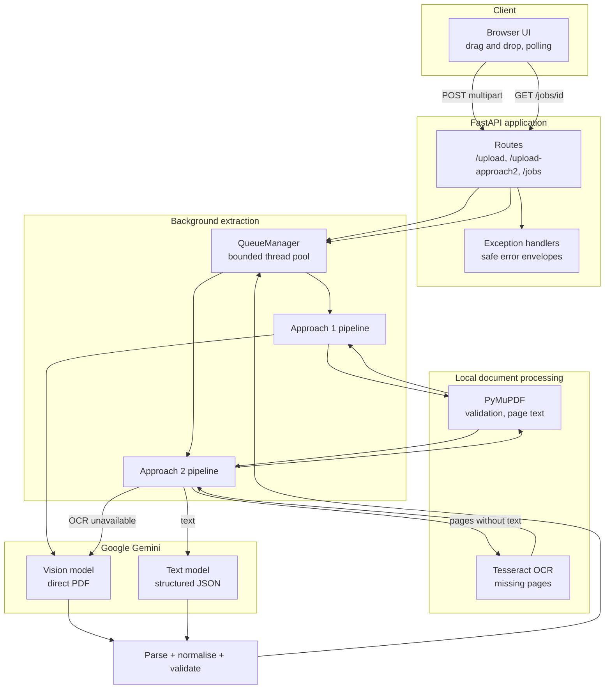
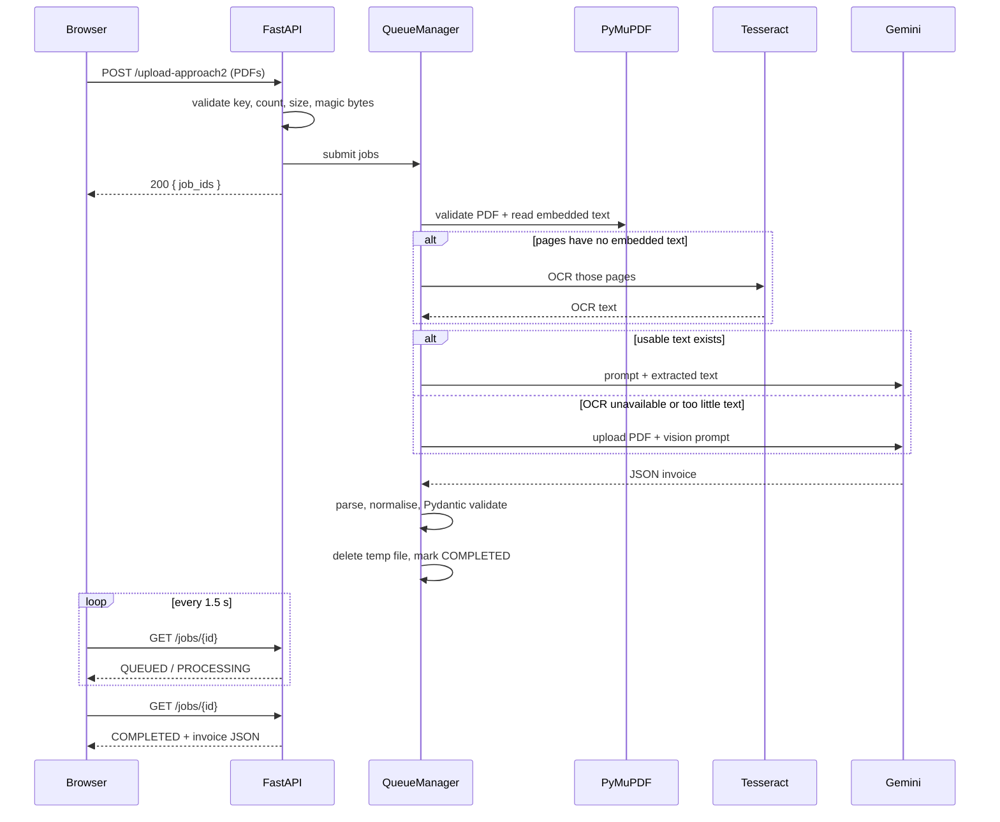

# Project Learning Guide

A walkthrough of how the Invoice LLM Extractor works, why it is built this way, and the concepts worth understanding before discussing it in an interview.

---

## 1. What you will learn

By studying this project you will understand:

- How to combine deterministic document processing (PyMuPDF, Tesseract) with an LLM.
- When to send a PDF to a vision model versus extracting text first.
- How to constrain an LLM to a strict JSON contract with a Pydantic schema.
- How to defend against hallucinated or malformed model output.
- How to design an asynchronous upload → poll job API with FastAPI.
- How to validate untrusted uploads and clean up temporary files.
- How to test an LLM-backed service without calling the real API.
- How to separate configuration, transport, business logic, and presentation.

---

## 2. The system in one paragraph

A user uploads one or more invoice PDFs. FastAPI validates them and hands each file to a background worker. The worker analyses the PDF with PyMuPDF. **Approach 1** uploads the PDF to Gemini and asks a vision model to extract the invoice. **Approach 2** extracts embedded text; if pages have no text, it runs Tesseract OCR and combines the results; only then does it ask Gemini to extract the invoice from text. In both cases the model returns JSON that is parsed, normalised, validated with Pydantic, stored with the job, and polled by the browser.

---

## 3. Architecture



### Why a queue at all?

Gemini calls take seconds. Doing them inside the upload request would make the browser wait, risk timeouts, and tie up an API worker. The upload endpoint validates and enqueues; the worker does the slow work; the client polls. This keeps the HTTP layer responsive and gives each job a clear state: `QUEUED → PROCESSING → COMPLETED | FAILED`.



---

## 4. End-to-end walkthrough

### Step 1 — Upload validation

`app/api/routes.py` checks:

1. Is a Gemini key configured?
2. Were any files sent?
3. Are there too many files?
4. Does each filename end in `.pdf`?
5. Does each file start with the `%PDF-` magic bytes?
6. Is each file within the byte limit?
7. Is each file non-empty?

Only then is the file saved, under a random UUID name, by `app/utils/files.py`. The original filename is sanitised and kept only for display. This prevents path traversal and filename collisions.

**Important:** blocking disk writes happen in a thread pool via `run_in_threadpool`, not on the event loop.

### Step 2 — PDF analysis

`app/services/pdf_service.py` opens the PDF once and:

- rejects corrupt, encrypted, or page-less documents,
- enforces the page limit,
- extracts text per page,
- classifies each page as having text or not,
- labels the whole document `Digital`, `Scanned`, or `Mixed`,
- truncates very long text before it reaches Gemini.

A page is considered digital when it contains at least `MIN_CHARS_PER_PAGE` characters. This threshold matters: a scanned page may contain a few stray characters from an OCR layer, so “any text at all” is a weak test.

### Step 3A — Approach 1

```text
PDF → Gemini Files API → wait for ACTIVE → vision prompt → JSON
```

The SDK wrapper in `app/services/gemini_client.py`:

- uploads the PDF with an explicit MIME type,
- polls file state until `ACTIVE`,
- times out safely,
- always deletes the remote file in a `finally` block,
- generates with temperature 0, JSON MIME type, and the Pydantic schema.

### Step 3B — Approach 2

```text
PDF text? ── yes ──→ Gemini text prompt ──→ JSON
   │
   └── no ──→ Tesseract OCR ──→ enough text? ── yes ──→ Gemini text
                                      │
                                      └── no ──→ Gemini Vision fallback
```

The approach label returned to the client records exactly which path ran. That is useful for debugging and for comparing cost and quality.

### Step 4 — Parsing and validation

The model is told to return JSON only, but production LLMs are not always obedient. Three layers handle this:

1. **`prompt.py`** states the rules and the exact field structure, including “never guess” and “return null”.
2. **`json_parser.py`** recovers a JSON object from fences, prose, BOMs, and balanced braces.
3. **`normalize.py`** maps common aliases (`vendor_name`, `qty`, `grand_total`) to canonical keys.
4. **`schemas/invoice.py`** validates types and coerces values such as `"₹ 1,234.50"` to `1234.50`.

If validation fails, the job fails with a safe message; the raw model output is not shown to the client.

### Step 5 — Result and cleanup

The worker stores a result envelope containing:

- the invoice object,
- the detected PDF type,
- the approach label,
- page count,
- timings for upload, text extraction, OCR, Gemini, and total,
- token usage,
- the model used.

The temporary PDF is deleted before the job becomes `COMPLETED` or `FAILED`, so a client that sees a terminal state can assume cleanup already happened.

### Step 6 — Frontend polling

`app/static/js/app.js`:

- validates that selected files are PDFs,
- posts to the endpoint chosen by the button,
- polls each job every 1.5 seconds,
- stops when every job is terminal or after 10 minutes,
- renders results with the existing CSS classes and safe `textContent` writes (no HTML injection),
- displays missing values as `Not Available`.

---

## 5. Module-by-module notes

| Module | Responsibility | Key lesson |
| --- | --- | --- |
| `config.py` | Typed settings from env / `.env` | Configuration is validated at startup; secrets use `SecretStr`. |
| `exceptions.py` | Typed errors with `status_code` and `public_message` | Separate what operators need from what clients may see. |
| `logging_config.py` | One logging setup | Central logging beats scattered `print` calls. |
| `schemas/invoice.py` | Invoice contract | Validation is also documentation; coercion tames messy model output. |
| `schemas/job.py` | Job and response envelopes | Keep transport models separate from domain models. |
| `utils/files.py` | Upload storage | Never trust a client filename as a path. |
| `utils/json_parser.py` | Tolerant JSON extraction | LLM output needs a parser, not just `json.loads`. |
| `utils/normalize.py` | Alias mapping | Models vary key names; normalise once at the boundary. |
| `services/pdf_service.py` | PDF analysis | Classify per page, not per document. |
| `services/ocr_service.py` | Tesseract integration | Rasterise only missing pages; handle missing binaries. |
| `services/gemini_client.py` | SDK wrapper | Retries, timeouts, model fallback, file lifecycle. |
| `services/prompt.py` | Prompt contract | Explicit null rules reduce hallucination. |
| `services/invoice_service.py` | Pipelines | Orchestration only; each dependency is replaceable. |
| `services/queue_manager.py` | Jobs and cleanup | Bounded concurrency and deterministic file cleanup. |
| `api/routes.py` | HTTP layer | Thin controllers; delegate to services. |
| `main.py` | App factory | Dependency injection makes tests fast and offline. |

---

## 6. The invoice data contract

Every field is optional. Missing values must be `null`; line items default to an empty list.

```json
{
  "supplier_name": null,
  "supplier_address": null,
  "supplier_gstin": null,
  "customer_name": null,
  "customer_address": null,
  "customer_gstin": null,
  "invoice_number": null,
  "invoice_date": null,
  "due_date": null,
  "currency": null,
  "subtotal": null,
  "total_tax": null,
  "cgst": null,
  "sgst": null,
  "igst": null,
  "invoice_total": null,
  "bank_details": null,
  "line_items": [
    {
      "description": null,
      "hsn_sac": null,
      "quantity": null,
      "unit_price": null,
      "tax_percentage": null,
      "amount": null
    }
  ],
  "items_purchased": []
}
```

Why `items_purchased`?

It is a display-friendly list derived from `line_items` for the existing frontend. It is deliberately derived rather than independently generated, so the UI never disagrees with the structured data. Existing values supplied by the model are preserved; missing ones are filled from line items.

Why not calculate totals?

Because calculation would hide extraction failures. If the invoice prints a total, copy it. If it does not, return `null`. Keeping extraction and computation separate makes errors visible and keeps the system honest.

---

## 7. Comparing the two approaches

| Dimension | Approach 1 — Vision | Approach 2 — Text / OCR |
| --- | --- | --- |
| Input to Gemini | PDF pages as images | Extracted text |
| Layout awareness | High | Limited to text order |
| Cost | Higher (vision tokens) | Lower for digital PDFs |
| Digital PDF speed | Good | Usually faster |
| Scanned PDF quality | Strong | Depends on OCR quality |
| Failure mode | Model/vision errors | OCR missing, noisy text |
| Fallback | None needed | Vision when OCR fails |
| Best use | Complex/scanned invoices | Bulk digital invoices |

A good answer in an interview is not “text is always cheaper” or “vision is always better”. It is: **text extraction is cheaper and more deterministic when the PDF already contains clean text; vision is more robust when the document is an image or layout carries meaning.** This project defaults to the cheaper path and escalates when needed.

---

## 8. Concurrency and job lifecycle

`QueueManager` uses `ThreadPoolExecutor`, because PyMuPDF, Tesseract, and the Gemini SDK calls are blocking. Running them directly in async endpoints would block the event loop.

```text
submit() → QUEUED
worker picks up → PROCESSING
callback returns → file cleanup → COMPLETED
callback raises AppError → safe message → FAILED
callback raises unexpected error → generic message + stack log → FAILED
```

Design details:

- A lock protects the in-memory job dictionary.
- Completed jobs expire after `JOB_TTL_SECONDS`; the store is capped at `MAX_JOBS`.
- `shutdown()` cancels pending futures and deletes their files.
- Uploaded files are deleted before a terminal status is published.
- Jobs are not persisted, so a restart loses history. That is an accepted trade-off for a single-process demo; Redis or a database would be the next step.

---

## 9. Error handling strategy

| Error class | HTTP status | Client sees |
| --- | --- | --- |
| `FileValidationError` | 400 | Invalid file / empty file |
| `UnsupportedFileTypeError` | 400 | Only PDF files are supported |
| `FileTooLargeError` | 413 | File too large |
| `PdfLimitError` | 413 | Too many pages / too much text |
| `CorruptPdfError` | 400 | Not a valid PDF |
| `PasswordProtectedPdfError` | 400 | Unlock the PDF |
| `OcrUnavailableError` | 503 | Install Tesseract or set path |
| `GeminiConfigurationError` | 503 | API key not configured |
| `GeminiServiceError` | 502 | AI service could not process |
| `ExtractionParseError` | 502 | AI response invalid |
| Unexpected `Exception` | 500 | Internal server error |

The principle: **log details, return safety**. A client should never see a stack trace, a filesystem path, or a raw upstream payload.

---

## 10. Testing strategy

The suite has **83 tests** and runs without a real API key.

| Test module | Focus |
| --- | --- |
| `test_json_parser.py` | Fences, prose, braces in strings, escaped quotes, invalid input |
| `test_schemas.py` | Number/currency coercion, null defaults, aliases, derived items |
| `test_pdf_extraction.py` | Digital/scanned/mixed classification, limits, encryption, corruption |
| `test_ocr.py` | Real Tesseract (when installed), mocked OCR, timeout, unavailable binary |
| `test_invoice_extraction.py` | Both pipelines, OCR fallback, parsing failures, envelope shape |
| `test_queue.py` | Completion, failure sanitisation, cleanup, TTL ordering, shutdown |
| `test_api.py` | Endpoints, uploads, validation, traversal, 404s, keep-uploads, docs |

Key techniques:

- **Dependency injection**: `create_app(settings=..., gemini_client=...)` lets tests swap in `FakeGeminiClient`.
- **Fixtures generate real PDFs** with PyMuPDF, so PDF code is exercised for real.
- **Monkeypatching** replaces OCR for deterministic pipeline tests.
- **Tests assert safe messages**, not internal details.
- **No network by default**; real model calls were validated manually with synthetic data.

Run:

```powershell
.\venv\Scripts\python.exe -m pytest
.\venv\Scripts\python.exe -m pytest --cov=app --cov-report=term-missing
.\venv\Scripts\ruff.exe check .
```

---

## 11. Design decisions and trade-offs

| Decision | Why | Trade-off |
| --- | --- | --- |
| OCR-first for scanned pages in Approach 2 | Cheaper and often accurate | More moving parts; OCR quality varies |
| Vision fallback | Keep the request useful when OCR fails | Some requests still pay vision cost |
| Pydantic response schema | Strong shape guarantees | Some models reject schemas; code retries without it |
| Temperature 0 | Deterministic extraction | Still not perfectly deterministic |
| In-memory job store | Simple, no infrastructure | Lost on restart; not multi-process safe |
| Thread pool | Blocking libraries are simpler than async rewrites | Bounded by `WORKER_THREADS` |
| Polling | Works everywhere, simple to debug | Slightly higher request volume than WebSockets |
| Never calculate totals | Preserve extraction truth | UI cannot fill gaps |
| Nulls instead of placeholders | Machine-readable, honest | Frontend must render `Not Available` |
| Temp files under UUIDs | Prevent traversal/collisions | Original names only exist in job metadata |

---

## 12. Production hardening checklist

This project is designed to run locally. Before exposing it publicly:

- [ ] Add authentication and per-user authorisation.
- [ ] Add rate limiting and request quotas.
- [ ] Move jobs and results to a shared store (Redis/PostgreSQL).
- [ ] Add a task queue (Celery/RQ/Arq) instead of in-process threads.
- [ ] Store uploads in object storage with lifecycle rules.
- [ ] Add antivirus/malware scanning for uploads.
- [ ] Add audit logging without logging invoice contents.
- [ ] Add metrics, tracing, and alerting.
- [ ] Pin and regularly update dependencies; run a vulnerability scan.
- [ ] Define data retention and a privacy policy for LLM processing.
- [ ] Add a license and contribution guidelines.
- [ ] Add CI (tests + lint) and a release process.

---

## 13. Interview questions and answers

### 1. Why two extraction approaches?

Because PDFs differ. Digital PDFs contain selectable text, so local extraction is cheaper, faster, and deterministic. Scanned PDFs are images, so OCR or a vision model is required. Keeping both lets the user choose and lets Approach 2 escalate automatically.

### 2. Why not always use Gemini Vision?

It is generally more expensive and can be slower. For a clean digital invoice, sending extracted text is sufficient and reduces vision token usage. Vision is reserved for images, complex layouts, or OCR failure.

### 3. How do you stop the model from inventing values?

Three layers: the prompt explicitly says “never guess” and “return null”; the response schema defines optional fields; and validation keeps missing values as `None`. The code does not calculate totals that were not printed.

### 4. What happens if the model returns markdown-fenced JSON?

`parse_json_object` first tries the raw string, then fenced blocks, then a balanced-brace scan. It handles braces inside strings and escaped quotes.

### 5. Why normalise keys before validation?

LLMs sometimes return `vendor_name` or `qty`. Normalising at the boundary keeps Pydantic models canonical and avoids scattering aliases throughout the codebase.

### 6. Why Pydantic instead of trusting JSON?

JSON only guarantees syntax. Pydantic enforces types, coerces currency strings, ignores unexpected keys, and produces a stable contract. It also generates the schema sent to Gemini.

### 7. Why is the Gemini client lazy?

The app must start even without an API key, and tests must not need one. The client is created on first use, so configuration errors surface as a clear 503 rather than a startup crash.

### 8. How do you handle Gemini rate limits?

Retryable HTTP statuses (429, 5xx) use exponential backoff with jitter, bounded by `GEMINI_MAX_RETRIES`. After exhausting retries for one model, the client tries the next configured model. Auth errors fail fast.

### 9. How are uploaded files protected?

The extension and `%PDF-` magic bytes are checked, size is enforced while streaming, the file is stored under a random UUID, and the original name is sanitised for display only. Files are deleted after processing unless explicitly kept.

### 10. Why save files at all instead of processing in memory?

PyMuPDF can open from bytes, but Gemini's Files API and OCR tooling work naturally with paths, and large files are easier to stream to disk. Paths also make cleanup and debugging explicit. The files are temporary and access-controlled.

### 11. Why a background queue instead of awaiting Gemini in the request?

Extraction takes seconds and can time out. A queue keeps the HTTP response fast, isolates failures per file, and allows bounded concurrency. Polling gives the client progress.

### 12. Why polling instead of WebSockets?

Polling is simpler, survives proxies, needs no connection management, and is easy to test. At this scale the extra requests are negligible. WebSockets would be justified for live progress or many concurrent users.

### 13. What happens if two users upload at once?

Each file gets its own job and UUID. A bounded thread pool processes up to `WORKER_THREADS` at a time; the rest wait in the executor queue. The job store is protected by a lock.

### 14. Why is `items_purchased` derived?

The original UI expects a list of display strings. Deriving it from `line_items` guarantees the UI and structured data agree, and avoids asking the model for duplicate information.

### 15. How do you test an LLM service without spending money?

Inject a fake client that returns canned JSON. Real PDF generation and real OCR still exercise the local pipeline. One optional live check can be run manually against synthetic samples.

### 16. How would you support more languages in OCR?

Install the Tesseract language packs and set `OCR_LANGUAGES`, for example `eng+hin`. Keep in mind that mixed-language OCR accuracy varies and may need preprocessing.

### 17. What is the biggest source of failure?

Poor input quality: low-resolution scans, skew, stamps over text, or unusual layouts. The system mitigates this with OCR preprocessing, a Vision fallback, and explicit nulls rather than guesses.

### 18. How would you make this horizontally scalable?

Move job state to Redis/PostgreSQL, replace the in-process executor with a distributed queue, store uploads in object storage, and make workers stateless. Add idempotency keys so retries do not duplicate work.

### 19. Why does the worker delete the file before marking the job complete?

So a client that observes `COMPLETED` can rely on cleanup having already happened. Otherwise a fast poll could see `COMPLETED` while the file still exists, which complicates retention and security guarantees.

### 20. How would you evaluate extraction accuracy?

Build a labelled dataset of invoices and compare field-level precision/recall, exact-match rates for totals and dates, and line-item matching. Track null rate separately from wrong-value rate, because a wrong value is worse than a null.

### 21. Why temperature 0?

Extraction is a deterministic task, not a creative one. Temperature 0 reduces variation, though model/provider nondeterminism can still occur.

### 22. What would you change for very large PDFs?

Process pages in batches, stream or chunk text, summarise or select relevant pages, enforce stricter page limits, and possibly use asynchronous batch APIs. Avoid sending the entire document when only a few pages matter.

---

## 14. Hands-on exercises

1. Add a new field, `purchase_order_number`, through the prompt, schema, API, and UI.
2. Add a per-line discount field and render it without changing the CSS classes.
3. Replace polling with Server-Sent Events and compare complexity.
4. Persist jobs in SQLite and add a `/jobs?status=FAILED` filter.
5. Add a `--live` pytest marker that calls Gemini on `sample_data` when a key is present.
6. Build a small labelled dataset and compute field-level accuracy for both approaches.
7. Add Prometheus metrics for job duration, failure rate, and token usage.
8. Dockerise the app with Tesseract installed in the image.

---

## 15. Glossary

| Term | Meaning |
| --- | --- |
| **Digital PDF** | A PDF containing selectable embedded text. |
| **Scanned PDF** | A PDF made of page images with little or no embedded text. |
| **Mixed PDF** | A PDF where some pages have text and others do not. |
| **OCR** | Optical Character Recognition; converting page images to text. |
| **Vision model** | A multimodal model that can read images or PDF pages directly. |
| **Structured output** | Constraining a model response to a schema such as JSON. |
| **Response schema** | The JSON schema derived from a Pydantic model and sent to Gemini. |
| **Hallucination** | A plausible but unsupported value invented by a model. |
| **Job** | A unit of background extraction work with a status and result. |
| **Polling** | Repeatedly requesting job status until it reaches a terminal state. |
| **Idempotency** | Making repeated requests produce the same effect once. |
| **TTL** | Time to live; how long a completed job remains available. |

---

## 16. Further reading

- FastAPI — <https://fastapi.tiangolo.com/>
- Pydantic — <https://docs.pydantic.dev/>
- Google Gen AI SDK — <https://googleapis.github.io/python-genai/>
- Gemini API docs — <https://ai.google.dev/gemini-api/docs>
- PyMuPDF — <https://pymupdf.readthedocs.io/>
- Tesseract — <https://tesseract-ocr.github.io/>
- pytesseract — <https://github.com/madmaze/pytesseract>
- MDN, Fetch API — <https://developer.mozilla.org/en-US/docs/Web/API/Fetch_API>
- Mermaid — <https://mermaid.js.org/>
