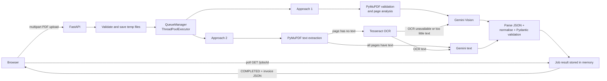

# Invoice LLM Extractor

Turn invoice PDFs into clean, validated JSON using Google Gemini, with two independent extraction pipelines:

| Approach | How it works | Best for |
| --- | --- | --- |
| **Approach 1 — Gemini Vision** | The PDF is uploaded to the Gemini Files API and sent directly to a vision model. | Complex layouts, stamps, signatures, and scanned documents where layout matters. |
| **Approach 2 — PyMuPDF + OCR + Gemini Text** | Embedded text is extracted locally with PyMuPDF. Pages without text are rasterised and read with Tesseract OCR. The resulting text is sent to Gemini. Falls back to Gemini Vision if OCR is unavailable or produces too little text. | Digital PDFs and mixed documents where text extraction is faster and cheaper. |

Both approaches return the **same JSON envelope**, so the frontend and downstream consumers do not need to care which pipeline produced the result.

---

## Features

- Two extraction approaches selectable from the UI and the API.
- Digital, scanned, and mixed PDF detection per page.
- Tesseract OCR fallback chain: embedded text → OCR → Gemini Vision.
- Structured Gemini output with a Pydantic schema and prompt-level guardrails.
- Explicit `null` values for missing fields — the model is instructed never to invent data.
- Vendor/customer details, GSTIN, invoice/due dates, currency, subtotal, CGST/SGST/IGST, total tax, invoice total, bank details, and line items (description, HSN/SAC, quantity, unit price, tax %, amount).
- Background job queue with bounded concurrency, polling API, TTL cleanup, and automatic temporary-file deletion.
- Upload validation: extension, PDF magic bytes, size, page count, and per-request file count.
- Typed application errors with client-safe messages; internal details stay in the logs.
- Centralised logging, environment-based configuration, and no secrets in source control.
- Responsive drag-and-drop UI with the original visual design preserved.
- 83 automated tests using a fake Gemini client (no API calls required), plus real OCR coverage when Tesseract is installed.

---

## Architecture



### Request lifecycle

1. The browser posts one or more PDFs to `/upload` (Approach 1) or `/upload-approach2` (Approach 2).
2. FastAPI validates the API key, file count, extension, size, and PDF signature, then writes each file under a random UUID name in `uploads/`.
3. A background job is queued and the API immediately returns `job_ids`.
4. A worker validates and analyses the PDF, chooses the extraction path, and calls Gemini.
5. The model response is parsed, normalised, and validated with Pydantic.
6. The temporary upload is deleted (unless `KEEP_UPLOADS=true`) and the job is marked `COMPLETED` or `FAILED`.
7. The browser polls `GET /jobs/{job_id}` and renders the result using the existing UI.

---

## Tech stack

| Layer | Technology |
| --- | --- |
| Web framework | FastAPI + Uvicorn |
| Templates / frontend | Jinja2, vanilla JavaScript, existing CSS |
| PDF processing | PyMuPDF (fitz) |
| OCR | Tesseract 5 via pytesseract + Pillow |
| LLM | Google Gen AI SDK (`google-genai`) |
| Validation / settings | Pydantic v2, pydantic-settings |
| Testing / linting | pytest, pytest-cov, ruff |

---

## Project structure

```text
invoice-llm-extractor/
├── app/
│   ├── api/
│   │   └── routes.py            # Pages, uploads, jobs, health endpoints
│   ├── schemas/
│   │   ├── invoice.py           # Invoice JSON contract and coercion
│   │   └── job.py               # Job / API response schemas
│   ├── services/
│   │   ├── gemini_client.py     # Gemini SDK wrapper, retries, file uploads
│   │   ├── invoice_service.py   # Approach 1 and Approach 2 pipelines
│   │   ├── ocr_service.py       # Tesseract integration
│   │   ├── pdf_service.py       # PDF validation, page analysis, text extraction
│   │   ├── prompt.py            # Shared extraction prompt and rules
│   │   └── queue_manager.py     # Background jobs and cleanup
│   ├── static/
│   │   ├── css/style.css        # Unchanged visual design
│   │   └── js/app.js            # Upload, polling, rendering
│   ├── templates/index.html     # Upload page with approach captions
│   ├── utils/
│   │   ├── files.py             # Secure upload handling
│   │   ├── json_parser.py       # Tolerant JSON extraction from model output
│   │   └── normalize.py         # Alias normalisation for model keys
│   ├── config.py                # Environment settings
│   ├── exceptions.py            # Typed, client-safe errors
│   ├── logging_config.py        # Central logging setup
│   └── main.py                  # App factory, lifespan, exception handlers
├── scripts/
│   ├── check_models.py          # Verify configured Gemini models
│   ├── generate_samples.py      # Create synthetic demo invoices
│   └── list_models.py           # List models available to your key
├── tests/                       # pytest suite (fake Gemini client)
├── sample_data/                 # Synthetic digital/scanned PDFs + expected output
├── uploads/                     # Temporary uploads (.gitkeep only in Git)
├── .env.example                 # Configuration template (no secrets)
├── pyproject.toml               # pytest and ruff configuration
├── requirements.txt             # Runtime dependencies
├── requirements-dev.txt         # Test and lint dependencies
└── run.py                       # Convenience launcher
```

---

## Requirements

- Python **3.10 or newer** (the project was tested on Python 3.14).
- A Google Gemini API key from <https://aistudio.google.com/app/apikey>.
- Tesseract OCR **optional but recommended** for scanned PDFs. Without it, Approach 2 falls back to Gemini Vision.

### Install Tesseract on Windows

```powershell
winget install --id UB-Mannheim.TesseractOCR --accept-package-agreements --accept-source-agreements
```

The app auto-detects the usual install locations:

- `C:\Program Files\Tesseract-OCR\tesseract.exe`
- `C:\Program Files (x86)\Tesseract-OCR\tesseract.exe`
- `%LOCALAPPDATA%\Programs\Tesseract-OCR\tesseract.exe`

If yours is elsewhere, set the full path in `.env`:

```dotenv
TESSERACT_CMD=C:\path\to\tesseract.exe
```

### Install Tesseract on Linux / macOS

```bash
# Debian / Ubuntu
sudo apt-get install tesseract-ocr

# macOS (Homebrew)
brew install tesseract
```

---

## Setup

```powershell
# 1. Create and activate a virtual environment
python -m venv venv
.\venv\Scripts\Activate.ps1

# 2. Install dependencies
python -m pip install -r requirements.txt

# 3. Create your local configuration
Copy-Item .env.example .env

# 4. Add your Gemini API key to .env
#    GEMINI_API_KEY=your-key-here

# 5. Run the app
python run.py
```

On Linux / macOS use `source venv/bin/activate` instead of the PowerShell activate command.

Open:

- UI: <http://127.0.0.1:8000/>
- Swagger docs: <http://127.0.0.1:8000/docs>

The app starts even when `GEMINI_API_KEY` is missing; uploads are rejected with a clear `503` until a key is configured.

---

## Configuration

All settings can be provided through environment variables or `.env`.

| Variable | Default | Purpose |
| --- | --- | --- |
| `GEMINI_API_KEY` | _(empty)_ | Required for extraction. Never commit it. |
| `GEMINI_MODELS` | `models/gemini-3.1-flash-lite,models/gemini-3.8-flash,...` | Comma-separated fallback list, tried in order. |
| `GEMINI_TIMEOUT_SECONDS` | `120` | Per-request timeout. |
| `GEMINI_MAX_RETRIES` | `3` | Attempts per model for retryable errors. |
| `GEMINI_USE_RESPONSE_SCHEMA` | `true` | Ask Gemini to follow the Pydantic response schema. |
| `MAX_UPLOAD_MB` | `10` | Maximum size of each PDF. |
| `MAX_FILES_PER_REQUEST` | `10` | Maximum files in one upload. |
| `MAX_PDF_PAGES` | `50` | Maximum pages per PDF. |
| `MAX_TEXT_CHARS` | `150000` | Text sent to Gemini is truncated above this limit. |
| `UPLOAD_DIR` | `uploads` | Temporary upload directory. |
| `KEEP_UPLOADS` | `false` | Keep PDFs after processing (useful for debugging). |
| `JOB_TTL_SECONDS` | `3600` | How long completed jobs stay in memory. |
| `MAX_JOBS` | `200` | In-memory job cap. |
| `WORKER_THREADS` | `3` | Concurrent extraction workers. |
| `OCR_ENABLED` | `true` | Enable Tesseract OCR. |
| `TESSERACT_CMD` | _(auto)_ | Explicit path to the Tesseract executable. |
| `OCR_LANGUAGES` | `eng` | Tesseract language packs. |
| `OCR_DPI` | `300` | Rasterisation DPI for OCR. |
| `OCR_TIMEOUT_SECONDS` | `60` | Per-page OCR timeout. |
| `MIN_CHARS_PER_PAGE` | `40` | Embedded text below this is treated as missing. |
| `MIN_OCR_CHARS` | `40` | OCR text below this triggers the Vision fallback. |
| `LOG_LEVEL` | `INFO` | Logging verbosity. |

Check which models your key can actually use:

```powershell
.\venv\Scripts\python.exe scripts\list_models.py
.\venv\Scripts\python.exe scripts\check_models.py
```

---

## API

Both upload endpoints are asynchronous. They return job IDs, and results are polled from `GET /jobs/{job_id}`.

| Method | Path | Description |
| --- | --- | --- |
| `GET` | `/` | Upload UI |
| `POST` | `/upload` | Approach 1 — Gemini Vision |
| `POST` | `/upload-approach2` | Approach 2 — PyMuPDF + OCR text |
| `GET` | `/jobs` | List jobs in creation order |
| `GET` | `/jobs/{job_id}` | Poll one job |
| `GET` | `/health` | Version, API key, and OCR status |
| `GET` | `/docs` | Swagger UI |
| `GET` | `/openapi.json` | OpenAPI schema |

### Upload with curl

```bash
curl -X POST http://127.0.0.1:8000/upload-approach2 \
  -F "invoices=@sample_data/sample_digital_invoice.pdf"
```

```json
{ "success": true, "job_ids": ["8f14e45fceea167a5a36dedd4bea2543"] }
```

### Poll a job

```bash
curl http://127.0.0.1:8000/jobs/8f14e45fceea167a5a36dedd4bea2543
```

```json
{
  "success": true,
  "job": {
    "id": "8f14e45fceea167a5a36dedd4bea2543",
    "filename": "sample_digital_invoice.pdf",
    "approach": "Approach 2",
    "status": "COMPLETED",
    "error": null,
    "created_at": "2026-10-31T20:40:00+00:00",
    "updated_at": "2026-10-31T20:40:05+00:00",
    "result": {
      "invoice": {
        "supplier_name": "ABC Technologies Pvt Ltd",
        "supplier_address": "12 MG Road, Bengaluru, Karnataka 560001",
        "supplier_gstin": "29ABCDE1234F1Z5",
        "customer_name": "XYZ Retail Solutions",
        "customer_address": "45 Park Street, Kolkata, West Bengal 700016",
        "customer_gstin": "19XYZAB5678C1Z2",
        "invoice_number": "INV-2026-0042",
        "invoice_date": "2026-04-01",
        "due_date": "2026-04-30",
        "currency": "INR",
        "subtotal": 55000.0,
        "total_tax": 9900.0,
        "cgst": 4950.0,
        "sgst": 4950.0,
        "igst": null,
        "invoice_total": 64900.0,
        "bank_details": "HDFC Bank, A/c 1234567890, IFSC HDFC0001234",
        "line_items": [
          {
            "description": "Cloud Hosting - April 2026",
            "hsn_sac": "998315",
            "quantity": 2.0,
            "unit_price": 15000.0,
            "tax_percentage": 18.0,
            "amount": 30000.0
          }
        ],
        "items_purchased": [
          "Cloud Hosting - April 2026 (HSN/SAC: 998315, Qty: 2, Unit: 15,000.00, Tax: 18%, Amount: 30,000.00)"
        ]
      },
      "pdf_type": "Digital",
      "approach": "PyMuPDF + Gemini Text",
      "page_count": 1,
      "upload_time": null,
      "text_extraction_time": 0.02,
      "ocr_time": null,
      "gemini_time": 4.1,
      "total_time": 4.2,
      "input_tokens": 1200,
      "output_tokens": 320,
      "total_tokens": 1520,
      "model": "models/gemini-3.1-flash-lite"
    }
  }
}
```

The complete example is in [`sample_data/sample_output.json`](sample_data/sample_output.json).

### Approach labels in results

| Result | Meaning |
| --- | --- |
| `Gemini Vision` | Approach 1. |
| `PyMuPDF + Gemini Text` | Approach 2 on a fully digital PDF. |
| `Tesseract OCR + Gemini Text` | Approach 2 on a fully scanned PDF with successful OCR. |
| `PyMuPDF + OCR + Gemini Text` | Approach 2 on a mixed PDF. |
| `Gemini Vision (OCR fallback)` | Approach 2 fell back to Vision because OCR was unavailable or produced too little text. |

### Error responses

Expected errors return a safe message:

```json
{ "success": false, "error": "Only PDF files are supported." }
```

Status codes:

- `400` — invalid file, too many files, corrupt/password-protected PDF.
- `413` — file too large or too many pages.
- `422` — malformed request.
- `502` — Gemini service failure.
- `503` — missing API key, OCR unavailable, or health dependency down.
- `500` — unexpected server error (details are logged, not returned).

---

## Testing

```powershell
# Full suite (no real Gemini calls)
.\venv\Scripts\python.exe -m pytest

# With coverage
.\venv\Scripts\python.exe -m pytest --cov=app --cov-report=term-missing

# Lint
.\venv\Scripts\ruff.exe check .
```

The tests use a fake Gemini client, so they do not spend API quota. Real OCR is exercised when Tesseract is installed; otherwise that single test is skipped.

Current status:

```text
83 passed
```

### Synthetic samples

```powershell
.\venv\Scripts\python.exe scripts\generate_samples.py
```

This creates `sample_data/sample_digital_invoice.pdf` and `sample_data/sample_scanned_invoice.pdf` containing fictional data.

---

## Security and privacy

- `.env` is ignored by Git; only `.env.example` is tracked.
- Uploaded PDFs are stored under random UUID names — client filenames are never used as paths.
- PDFs are deleted after processing by default (`KEEP_UPLOADS=false`).
- Uploaded Gemini files are deleted in a `finally` block after each request.
- Client errors are sanitised; stack traces and upstream details stay in server logs.
- The API key is wrapped in `SecretStr` and never returned by the API.
- Add authentication before exposing this service publicly: the current API has no user accounts or rate limiting.
- Invoice content is sent to Google Gemini; review your data-handling obligations before using real customer data.

---

## Troubleshooting

| Symptom | Fix |
| --- | --- |
| `503 Gemini API key is not configured` | Add `GEMINI_API_KEY` to `.env` and restart. |
| `429 RESOURCE_EXHAUSTED` | You hit the free-tier quota. Wait, use another model in `GEMINI_MODELS`, or enable billing. |
| `404 NOT_FOUND` for a model | That model is unavailable to your key. Run `scripts/list_models.py` and update `GEMINI_MODELS`. |
| OCR says unavailable | Install Tesseract or set `TESSERACT_CMD`. Approach 2 still works via Vision fallback. |
| Scanned PDF returns poor data | Try Approach 1; increase `OCR_DPI`; install the relevant language pack. |
| Text PDF returns little text | It may be scanned or use vector outlines. Use Approach 1. |
| Upload rejected as not a PDF | The file is not a real PDF (or is encrypted/corrupt). |
| Swagger shows no `/` route | The UI is intentionally excluded from the schema; open `http://127.0.0.1:8000/`. |

---

## Limitations

- Jobs are stored in process memory. Restarting the server clears history, and multiple workers would need a shared store such as Redis.
- The API has no authentication or rate limiting.
- The free Gemini tier has strict per-model daily quotas.
- Extraction quality depends on input quality; values that are not printed remain `null` by design.
- OCR supports the languages installed in Tesseract (`eng` by default).

---

## License

No license has been chosen for this repository yet. Add one before distributing or accepting external contributions.
